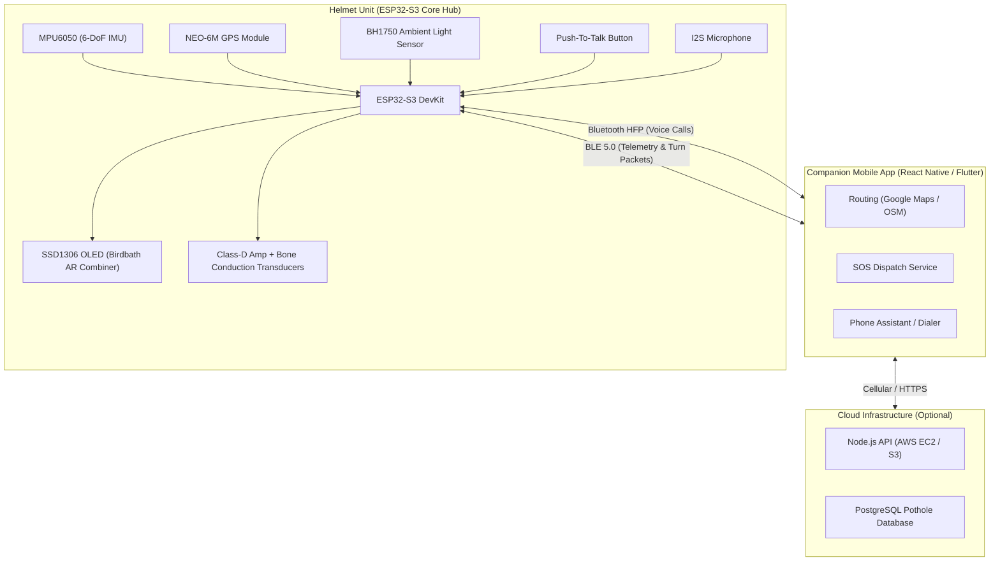

# 🏍️ AI-Assisted AR Helmet Navigation System

> **Turn-by-turn AR guidance, road-hazard awareness, and hands-free voice assistance — built directly into the ride.**

[](https://opensource.org/licenses/MIT)
[](https://www.espressif.com/)
[](https://platformio.org/)
[](https://colab.research.google.com/drive/1dOddPLRgAFKLsdCTcXO1J4sgXiA_Q1Wm?usp=sharing)
[]()

> 🌟 **Branch: `ml-pothole-training`**  
> This branch is dedicated to the **Pothole Detection ML pipeline**: training notebooks, edge model exports (NCNN/ONNX), and Banana Pi BPI-M4 real-time inference.  
> 👉 **See the complete guide in [POTHOLE_TRAINING.md](POTHOLE_TRAINING.md)** or open the [Interactive Google Colab Notebook](https://colab.research.google.com/drive/1dOddPLRgAFKLsdCTcXO1J4sgXiA_Q1Wm?usp=sharing).

---

## 📌 Project Overview

Motorcycle riders encounter severe road safety hazards from frequent distractions:
- Glancing down at handlebar-mounted smartphone navigation displays while navigating at high speeds.
- Hitting unexpected potholes, unmarked speed breakers, and road surface dips.
- Handling phone calls one-handed or struggling against deafening wind noise.

The **AI-Assisted AR Helmet Navigation System** projects critical navigation indicators, hazard alerts, and real-time telemetry straight into the rider’s natural field of vision through a lightweight optical combiner, while delegating heavy computational tasks to a companion smartphone via Bluetooth Low Energy (BLE).

Inspired by commercial smart helmets like **Jarvish** and **CrossHelmet**, the system architecture features a balanced hardware/software split:
- **Sense + Display (Helmet Unit):** Low-latency sensor fusion (GPS, IMU, ambient light), birdbath AR display rendering, bone-conduction transducers, and Push-To-Talk audio controls powered by an ESP32-S3 microcontroller.
- **Think + Connect (Companion Smartphone):** Navigation routing, cellular connectivity, crash dispatch, and cloud hazard mapping.

---

## 🚀 Core Features

| Feature | Description |
| :--- | :--- |
| **👓 AR Turn-by-Turn Navigation** | Visual arrows and distance indicators projected directly in the rider’s peripheral line of sight via an optical beamsplitter combiner — no glancing down required. |
| **⚠️ Pothole & Road Hazard Alert** | Camera detections are converted into a clear `LEFT`, `CENTER`, or `RIGHT` avoidance arrow; IMU/GPS events can also be logged for hazard mapping. |
| **🚨 Crash & Fall Detection (SOS)** | Detects rapid deceleration and orientation flip; automatically triggers an emergency SMS/call with live GPS coordinates to pre-configured emergency contacts. |
| **🎧 AI Music Dimming** | Automatic audio ducking that lowers media volume whenever turn prompts, incoming calls, or hazard warnings are announced. |
| **📞 Hands-Free AI Voice Assistant** | Bluetooth HFP bridge to Google Assistant / Siri triggered by a physical helmet-mounted push-to-talk (PTT) button. |
| **🔊 Adaptive Ambient Sound** | Bone-conduction audio transducers paired with an I2S mic enhance traffic and horn frequencies while attenuating wind noise. |
| **🛑 Overspeed & Geofence Alerts** | Compares GPS-derived ground speed against speed-limit tables in the companion app, flashing HUD warnings if exceeded. |
| **📷 Vision-Based Hazards (Stretch)** | Forward-facing camera module paired with edge YOLOv8-nano for real-time visual road obstacle recognition. |

---

## 🏗️ System Architecture



---

## 👓 Deep Dive: AR Display Subsystem

Waveguide optics are prohibitively expensive for early-stage prototyping. This design uses a proven **birdbath / beamsplitter combiner**:
1. **Micro-Display:** High-contrast 0.96" SSD1306 I2C OLED display oriented inside the helmet brow.
2. **Semi-Reflective Combiner:** 45-degree angled semi-reflective acrylic plate projecting virtual navigation symbology focused to infinity in the rider's upper peripheral vision without obstructing forward view.
3. **Auto-Brightness Control:** A BH1750 digital ambient light sensor reads external illuminance (lux) and adjusts display contrast and PWM duty cycle for seamless visibility in direct sunlight and glare-free riding at night.

---

## 🛠️ Hardware Bill of Materials (Core MVP)

Costs reflect Indian hobbyist-market component pricing for a single prototype unit (~**₹6,500 – ₹9,500** / ~$80–$115 USD):

| Subsystem | Key Components | Approx. Cost (₹) |
| :--- | :--- | :--- |
| **Compute** | ESP32-S3 DevKit (Dual-core, BLE 5.0) | ₹1,750 |
| **AR Display** | SSD1306 OLED + Combiner Optics + BH1750 Sensor | ₹700 |
| **Navigation & Motion** | NEO-6M GPS Module + MPU6050 IMU | ₹390 |
| **Audio Subsystem** | Bone-conduction transducers + Class-D Amp + I2S Mic | ₹1,050 |
| **Power Management** | 18650 Li-ion Battery + TP4056 Charger + 3.3V LDO | ₹530 |
| **User Controls** | Waterproof momentary Push-to-Talk (PTT) switch | ₹50 |
| **Enclosure & Mounts** | Spare helmet shell + 3D-printed mounts + fasteners | ₹2,200 |
| **Total Core MVP** | | **≈ ₹6,500 – ₹9,500** |

> *Optional stretch modules (+₹1,000–4,000): Vision-based pothole camera (OV2640/ESP32-CAM), standalone GSM/LTE fallback, LoRa group intercom.*

---

## 💻 Software Stack

- **Helmet Firmware (`/firmware`):** C++ written with [PlatformIO](https://platformio.org/) / Arduino Core for ESP32-S3. Manages I2C sensor bus, display framebuffer, BLE GATT server, and hardware UART listener for Banana Pi vision alerts.
- **Vision AI on Banana Pi BPI-M4 (`/vision-ai`):** Real-time YOLOv8-nano (NCNN/ONNX) pothole detection runner with camera capture, rider lane gating (25%–75%), minimum danger area filtering, and UART alert streaming to ESP32-S3. Includes the full Google Colab training notebook.
- **Companion Mobile App (`/mobile-app`):** Built with React Native / Flutter. Handles turn-by-turn routing (Google Maps / OpenStreetMap APIs), translates route waypoints into compact BLE binary packets, and handles SOS dispatch.
- **AI & Edge Intelligence:**
  - `YOLOv8-nano` on NCNN for ARM NEON edge execution on Banana Pi BPI-M4.
  - `Picovoice Porcupine` for low-latency wake-word and intent recognition.
- **Backend Service (`/backend`):** Node.js API with spatial database (PostgreSQL/PostGIS) for crowdsourced pothole telemetry.

> **Hardware (as-built prototype):** the working bench prototype runs the compute
> and vision on a **Banana Pi M4 (Armbian)**, takes positioning + cellular from a
> **Waveshare SIM7600X** (GNSS + 4G LTE) instead of a wired NEO-6M, and uses an
> **ESP32-CAM** running the stock `CameraWebServer` sketch as the forward camera
> (consumed as an MJPEG stream over Wi-Fi). The ESP32-S3 keeps its helmet-side
> HUD / audio / BLE role. See [`docs/PROGRESS.md`](docs/PROGRESS.md) and
> [`hardware/wiring/sim7600x.md`](hardware/wiring/sim7600x.md).

---

## ⚠️ Key Engineering Challenges & Mitigations

1. **Safety Certification:** Modifying an ISI/DOT-certified helmet voids safety ratings. All prototyping, fitment, and drop tests are carried out on spare/dummy test shells with non-invasive bracket mounts.
2. **Optics Alignment:** Achieving a clean floating virtual image requires fine focal tuning. Modular 3D-printed adjustment brackets are used to tune eye-relief distance.
3. **Battery & Thermal Management:** Component layout separates high-discharge Li-ion cells from rider contact points, incorporating silicone thermal pads and ventilation channels.

---

## 📂 Repository Organization

```text
├── firmware/              # ESP32-S3 PlatformIO source code
│   ├── include/           # Header files & pin definitions
│   ├── src/               # Sensor fusion, BLE server, display & BPI UART logic
│   └── platformio.ini     # PlatformIO environment configuration
├── vision-ai/             # Banana Pi BPI-M4 YOLOv8 edge vision pipeline & Colab notebook
│   ├── bpi_inference.py   # Real-time edge runner; local camera or ESP32-CAM stream + UART telemetry
│   ├── gps_sim7600x.py    # Waveshare SIM7600X GNSS reader (JSON out, optional UART forward)
│   ├── train.py           # Training & NCNN/ONNX export script
│   ├── requirements.txt   # Python dependencies
│   ├── pothole_detection_colab.ipynb # Original Google Colab training notebook
│   └── README.md          # Banana Pi M4 wiring, setup & systemd autostart guide
├── mobile-app/            # Companion app specifications & code
├── hardware/              # Hardware docs, BOM & optical diagrams
│   ├── optics/            # AR combiner optical design & mount specs
│   ├── wiring/            # Module wiring & bring-up notes (SIM7600X, …)
│   └── BOM.md             # Detailed parts list & sourcing
├── docs/                  # Architectural diagrams & specifications
│   ├── ARCHITECTURE.md    # Data-flow & hazard/crash logic
│   └── PROGRESS.md        # Build progress log (as-built hardware, milestones, next steps)
├── LICENSE                # MIT License
└── README.md              # Project documentation
```

---

## 👥 Contributors

- [**S Sanjith** (@Sanjith-Jam)](https://github.com/Sanjith-Jam)
- [**Rayna Agarwal** (@raynaagarwal01-rgb)](https://github.com/raynaagarwal01-rgb)
- [**Maxime Mahieu Jose** (@MaximeMahieu)](https://github.com/MaximeMahieu)
- **Kavin Ram**
- [**Khirabdi Tanaya Dash** (@Kettydee)](https://github.com/Kettydee)

*Innovative Design Project*
